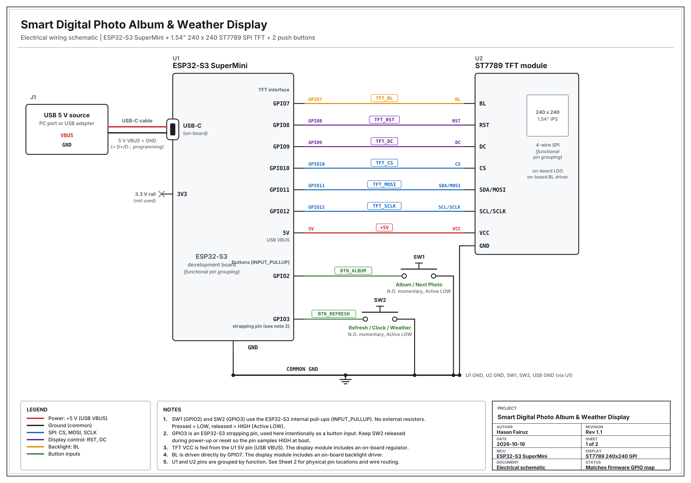
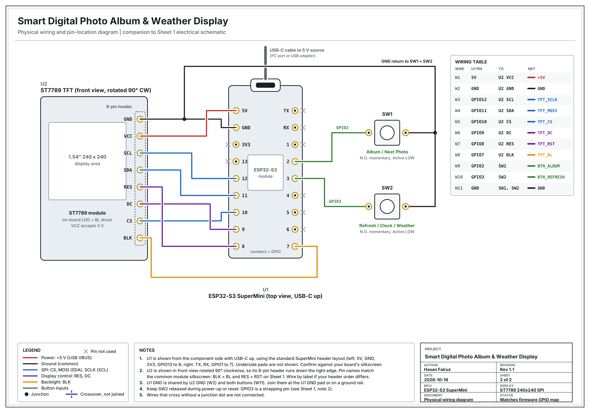

<div align="center">

# 📸 Smart Digital Photo Album & Weather Display

**ESP32-S3 SuperMini · 1.54-inch ST7789 TFT · Arduino C++ · Wi-Fi · LittleFS**

A compact, custom-built embedded photo album that displays locally stored photographs and provides an on-demand clock, date, and current-weather interface—controlled using two physical push buttons.

[](firmware/OurPhotoAlbum/OurPhotoAlbum.ino)
[](#-hardware-design)
[](docs/TEST_PLAN.md)
[](https://hasanfairuz.com)

</div>

---

## 🔎 Project Overview

This personal mechatronics project combines embedded programming, electronics integration, graphical interface design, and 3D-printable mechanical design. An **ESP32-S3 SuperMini** drives a **240 × 240 ST7789 display** and reads two physical buttons. Photographs are decoded from local **LittleFS** storage; Wi-Fi is used to synchronize time and retrieve current weather through **Open-Meteo**.

The prototype has been **compiled, uploaded, and tested on the assembled device**. Its principal functions were checked by operating the buttons and visually inspecting the display. See the [hardware validation report](docs/TEST_PLAN.md) for the scope and limitations of that testing. Offline functionality is implemented in firmware but the complete offline/reconnection test sequence remains to be formally documented.

### ✨ Key Features

- **Digital photo album:** Displays up to 25 locally stored 240 × 240 baseline JPEG images, using JPEGDEC and LittleFS.
- **Physical interaction:** Dedicated buttons for entering/navigating the album and refreshing the information screen.
- **Clock and date:** Network time synchronization with configurable timezone and daylight-saving rules.
- **Current weather:** Temperature, weather condition, wind speed, and day/night information from the Open-Meteo API.
- **Multi-network Wi-Fi:** Configurable network list, scanning, connection attempts, and fallback behaviour.
- **Offline-oriented design:** Locally stored photographs remain independent of a weather-data connection; missing unsynchronized information is represented by placeholders.
- **Responsive interface:** Screen-state logic, timed transitions, GPIO input handling, and a FreeRTOS-based refresh task.
- **Physical enclosure:** 3D-printable CAD/STL models and corresponding CAD images have been developed for the prototype.

## 📷 Prototype Photos & Mechanical Design

The photographs below document the working physical prototype and stages of hardware integration. These are **actual project images**, not illustrative renders.

| Completed mini photo album | Clock/weather display |
|:---:|:---:|
|  |  |

| Early breadboard prototype | PCB-board prototype | Under-display connections |
|:---:|:---:|:---:|
|  |  |  |

### 🧱 CAD Renders & 3D-Printable Parts

| Housing render | Housing sketch | Additional CAD render |
|:---:|:---:|:---:|
|  |  |  |

**Available STL files:**

- [Front Housing 4.0.STL](mechanical/CAD/Front%20Housing%204.0.STL)
- [Rear Housing 5.0.STL](mechanical/CAD/Rear%20Housing%205.0.STL)
- [Rear Housing 6.0.STL](mechanical/CAD/Rear%20Housing%206.0.STL)

These files represent available design iterations. Review geometry, tolerances, print orientation, and fit against the actual parts before using them for a new build; later revision numbers do not independently establish compatibility with every other file.

**Demonstration video:** A video link can be added once its repository location or published URL is confirmed. No video filename was visible in the provided directory listing, so no unverified link is included here.

## 🧩 System Architecture

```text
Album button (GPIO2) ─┐
                      ├──> ESP32-S3 firmware / display-state logic ──> ST7789 TFT
Refresh button (GPIO3)┘                     ▲
                                           │
LittleFS photos ──> JPEGDEC ────────────────┤
Wi-Fi ──> NTP / timezone ───────────────────┤
      └──> Open-Meteo API / JSON ──────────┘
```

- `setup()` initializes the display, SPI interface, button handling, photo filesystem, and startup services.
- `loop()` handles user inputs, slideshow progression, screen rendering, and display timeouts.
- A GPIO interrupt captures album-button activity; a FreeRTOS task handles network-information refresh.
- JPEGDEC processes locally stored photographs for rendering on the TFT.

## 🔌 Hardware Design

| Component | Function |
|---|---|
| ESP32-S3 SuperMini | Firmware execution, Wi-Fi, local file storage, and peripheral control |
| 1.54-inch ST7789 TFT, 240 × 240 | Photo album and information display |
| Two normally-open momentary buttons | Album navigation and clock/weather refresh |
| USB-C power connection | Supplies power to the development board |
| Connecting wires and mechanical enclosure | Electrical interconnect and physical packaging |

### Firmware Pin Map

| ESP32-S3 GPIO | Connection | Function |
|---|---|---|
| GPIO7 | TFT BL/BLK | Backlight control |
| GPIO8 | TFT RST/RES | Display reset |
| GPIO9 | TFT DC | Data/command selection |
| GPIO10 | TFT CS | SPI chip select |
| GPIO11 | TFT SDA/MOSI | SPI data |
| GPIO12 | TFT SCL/SCLK | SPI clock |
| GPIO2 | Album button to GND | Active-LOW input; internal pull-up |
| GPIO3 | Refresh button to GND | Active-LOW input; internal pull-up |

The assembled prototype uses a display module with a regulator suitable for its documented **5 V VCC** supply and onboard backlight interface circuitry, as confirmed for the specific module used. **Do not assume interchangeable ST7789 breakout boards support the same wiring.** GPIO3 is intentionally used as a button input; because it is an ESP32-S3 strapping pin, the refresh button should not be held during power-up or reset. The physical pin positions in the drawings correspond to the SuperMini board used in this build.

### Electrical Schematic



### Physical Wiring Diagram



**Additional hardware files:** [BOM with estimated CAD replacement costs](hardware/BOM.md). The BOM costs are estimates, **not actual historical purchase prices**.

## 🧰 Software & Dependencies

- **Arduino IDE** with **ESP32 by Espressif Systems** board support for the ESP32-S3 SuperMini.
- **ESP32 core libraries:** `WiFi`, `WiFiClientSecure`, `HTTPClient`, `SPI`, `LittleFS`, and standard time utilities.
- **External libraries:** Adafruit GFX Library; Adafruit ST7735 and ST7789 Library; ArduinoJson; JPEGDEC (Larry Bank).
- The firmware contains LEDC compatibility handling for different Arduino-ESP32 core versions. **ArduinoJson 6** is the safest starting point for its `DynamicJsonDocument` usage until other versions are verified.

For a fully reproducible build, record the exact dependency versions and Arduino IDE board-menu settings from the tested development environment.

## 🚀 Build, Configure & Run

1. Install Arduino IDE, the appropriate ESP32 board package, and the external libraries listed above.
2. Open [`firmware/OurPhotoAlbum/OurPhotoAlbum.ino`](firmware/OurPhotoAlbum/OurPhotoAlbum.ino).
3. In the same sketch folder, copy `config.example.h` to **`config.h`** and enter your own Wi-Fi SSIDs/passwords, weather location, timezone, and NTP configuration. See [`docs/CONFIGURATION.md`](docs/CONFIGURATION.md).
4. Prepare **240 × 240 baseline JPEG** images (`.jpg`/`.jpeg`) for LittleFS. The firmware indexes up to **25** photos. Keep private photographs outside version control.
5. Upload the image files to LittleFS using a filesystem uploader compatible with your installed Arduino IDE and ESP32 core. **Uploading the sketch alone does not upload LittleFS photos.**
6. Select the correct ESP32-S3 board, port, and a partition scheme with adequate LittleFS space; compile and upload the firmware.
7. Open Serial Monitor at **115200 baud** for diagnostics and follow the [functional test document](docs/TEST_PLAN.md).

**Security:** Keep `config.h` untracked and excluded by `.gitignore`. Review the repository history before public release; ignore rules do not remove previously committed secrets.

## 🎛️ Controls & Operating Behaviour

| Control | Behaviour |
|---|---|
| Album button — GPIO2 | Opens the photo album and advances its introduction, title, and photos |
| Refresh button — GPIO3 | Leaves album mode, shows a refresh screen, and returns to clock/weather information |
| Reset/EN | Restarts the system and reinitializes the startup sequence |

The firmware configures approximately **3-second** introductory/title and refresh intervals, **5 seconds** per photo, and **10 seconds** for the information screen. These are programmed durations, not independently measured timing benchmarks.

## ✅ Testing & Validation

The assembled prototype successfully ran firmware **v1.5** using the externalized local configuration. Initial **manual functional verification** covered successful upload/startup, normal Wi-Fi connection, clock and weather display, photo rendering, slideshow operation, both physical buttons, and screen transitions.

Testing was based on observed behaviour of the actual device—not automated test coverage or calibrated measurements. **Offline and reconnection scenarios, extended endurance, precise timing, and electrical performance remain outside the documented initial validation.**

See **[Hardware Testing & Validation](docs/TEST_PLAN.md)** for the test table, observations, and outstanding tests.

## 📁 Repository Guide

```text
smart-digital-photo-album/
├── README.md
├── .gitignore
├── docs/
│   ├── CONFIGURATION.md
│   └── TEST_PLAN.md
├── firmware/
│   └── OurPhotoAlbum/
│       ├── OurPhotoAlbum.ino
│       └── config.example.h
├── hardware/
│   ├── BOM.md
│   ├── smart_photo_album_physical_wiring.png
│   └── smart_photo_album_schematic.png
├── mechanical/
│   ├── CAD/
│   │   ├── Front Housing 4.0.STL
│   │   ├── Rear Housing 5.0.STL
│   │   └── Rear Housing 6.0.STL
│   └── renders/
│       ├── CAD Housing Render.png
│       ├── CAD Housing Sketch.png
│       └── CAD Render.png
└── media/
    ├── Clock Display.png
    ├── Early Breadboard Prototype.jpg
    ├── Mini Photo Album.png
    ├── PCB Board Prototype.png
    └── Under Display Connections.jpg
```

The locally created `firmware/OurPhotoAlbum/config.h` contains private configuration and is **intentionally excluded from Git**. The screenshot used for this directory inventory did not display a video file; include one in the README only after its path has been confirmed.

## ⚠️ Known Limitations & Future Improvements

- **Network security:** The current weather client uses `setInsecure()`, which disables TLS certificate validation. Implement proper certificate verification for secure deployment.
- **Offline recovery:** Verify complete startup-without-Wi-Fi and reconnection workflows on hardware.
- **Input/boot considerations:** GPIO3 is a strapping pin; avoid holding its button at reset.
- **Hardware interchangeability:** Substitute TFT modules may have different power or backlight requirements.
- **Photo constraints:** Only 240 × 240 baseline JPEGs are supported; a maximum of 25 photos is indexed.
- **Reliability:** Long-term operation, race conditions, current draw, and actual display timing have not been formally characterized.

## 🙌 Acknowledgements

Weather information is provided through [Open-Meteo](https://open-meteo.com/), and time synchronization uses network time services. Third-party firmware libraries remain subject to their respective licenses and attribution requirements.

## 👤 Author

**Hasan Fairuz**  
Mechatronic Systems Engineering · Simon Fraser University

[](https://github.com/HasanFairuz) [](https://hasanfairuz.com)

*This repository documents an independently developed engineering prototype. No repository license has been selected; public availability alone does not grant permission to reuse the author's code.*
